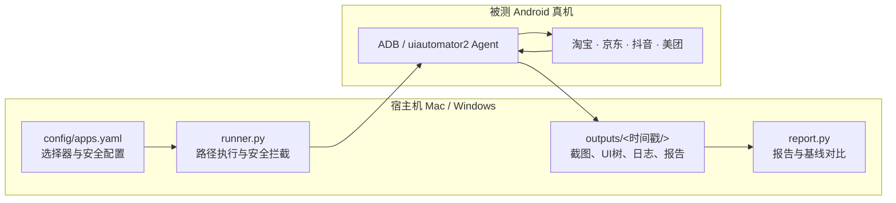

# Android 竞品 App 路径巡检系统

面向产品经理、用户体验研究和竞品分析场景的 Android 真机巡检工具。项目通过 ADB 与 `uiautomator2` 驱动用户授权的 Android 设备，按照可配置的用户路径访问淘宝、京东、抖音和美团，记录页面变化、营销触点与结算路径，并生成可复核的巡检报告。

> **项目状态**：MVP / 实验性工具
>
> **当前适配设备**：小米 14 Ultra（HyperOS；Android 14+）
>
> **仓库**：[felix6328/competitor-app-inspector-mvp](https://github.com/felix6328/competitor-app-inspector-mvp)

## 目录

- [项目简介](#项目简介)
- [核心能力](#核心能力)
- [安全与合规边界](#安全与合规边界)
- [工作原理](#工作原理)
- [快速开始](#快速开始)
- [运行参数](#运行参数)
- [输出与基线对比](#输出与基线对比)
- [定时运行](#定时运行)
- [选择器维护](#选择器维护)
- [项目结构](#项目结构)
- [限制与后续方向](#限制与后续方向)

## 项目简介

本项目将一次竞品体验拆解为可重复执行的路径：

```text
启动 App → 处理常见弹窗 → 搜索商品 → 进入商品详情
→ 识别营销与优惠触点 → 进入结算/支付方式页
→ 保存证据 → 在支付边界前主动停止
```

每次运行都会生成截图、UI 层次树、结构化事件流和 Markdown/JSON 报告，便于回答以下问题：

- 搜索到商品详情之间是否新增了入口、弹窗或推荐位？
- 优惠券、满减、红包、会员权益和银行卡优惠在哪一步出现？
- 结算路径、SKU 选择和支付方式入口是否发生变化？
- 本次运行与历史基线相比，页面文案、营销触点和视觉画面有哪些差异？

项目定位是“体验观察与证据归档”，不是下单、支付或风控绕过工具。

## 核心能力

| 能力 | 说明 |
| --- | --- |
| 多 App 路径巡检 | 支持淘宝、京东、抖音、美团；每个平台的包名、选择器和文案均可独立配置。 |
| 真机自动化 | 通过 USB ADB 或无线 ADB 连接 Android 真机，宿主机运行 Python 控制器。 |
| 营销触点识别 | 从 UI 文案和节点上下文中提取优惠券、满减、红包、会员、大促及银行卡优惠等信号。 |
| 证据采集 | 为关键步骤保存 PNG 截图、XML UI 树、`actions.jsonl` 和可读日志。 |
| 基线对比 | 使用 Pillow dHash 与 UI 文本集合比较页面视觉、文案和营销活动变化。 |
| 安全停止 | 检测到登录/风控、敏感输入框或支付方式/收银台特征时，保存现场并停止。 |

## 安全与合规边界

安全边界是本项目的前置条件，而不是运行后的人工补救：

1. **不输入支付凭据**：不输入银行卡号、CVV、有效期、短信验证码、支付密码或其他敏感凭据。
2. **不提交交易**：禁止点击“提交订单”“立即支付”“确认支付”“去支付”等可能产生实际扣款的操作。
3. **支付边界主动停止**：识别到收银台、支付方式、银行卡列表或敏感输入框后，立即保存证据并停止。
4. **不绕过登录与风控**：遇到登录、验证码、滑块、人机验证或风控拦截时停止，不尝试破解或规避。
5. **仅使用授权账号与设备**：只在用户拥有或明确获准使用的设备和账号上运行，并遵守相关 App 的服务条款。
6. **谨慎处理输出文件**：截图、UI XML 和设备环境文件可能包含昵称、地址、订单或设备标识。`outputs/` 和 `baseline/` 默认不进入 Git，但分享报告前仍应人工脱敏。
7. **关闭闲置调试入口**：无线调试只在需要时开启，任务完成后建议关闭并撤销不再使用的 USB 调试授权。

项目不会主动向第三方上传巡检结果；运行过程会通过 ADB/uiautomator2 在宿主机与被测手机之间传输控制指令和页面证据。依赖安装阶段会访问 Python 包仓库，这是正常的软件安装行为。

## 工作原理



宿主机负责路径编排、规则判断、证据保存和报告生成；手机只运行官方 App 与自动化代理，不需要编译或安装本项目的手机端 APK。

## 快速开始

### 1. 准备 Android 真机

在手机的开发者选项中开启 **USB 调试**；如果使用无线 ADB，再开启 **无线调试**并完成配对。首次连接时，在手机上确认“允许 USB 调试”。

建议：

- 使用测试账号，不要在巡检账号中保存免密支付或可直接扣款的支付方式。
- 保持屏幕常亮，避免系统锁屏中断路径。
- 任务结束后关闭无线调试，并撤销不需要的调试授权。

### 2. 安装宿主机依赖

macOS 推荐使用 Homebrew：

```bash
git clone https://github.com/felix6328/competitor-app-inspector-mvp.git
cd competitor-app-inspector-mvp
brew install android-platform-tools
./bootstrap_mac.sh
```

Windows 用户请安装 [Android SDK Platform-Tools](https://developer.android.com/tools/releases/platform-tools)，并将 `adb` 所在目录加入 `PATH`。随后使用 Python 3.9+ 创建虚拟环境并安装依赖：

```bash
python -m venv .venv
.venv\Scripts\activate
pip install -r requirements.txt
```

### 3. 连接并预检

```bash
adb devices
./.venv/bin/python preflight.py
```

如果只想检查宿主机依赖、暂时没有连接手机：

```bash
./.venv/bin/python preflight.py --allow-no-device
```

当 `adb devices` 显示设备状态为 `device`，且四个目标 App 已安装，即可开始巡检。

### 4. 执行一次巡检

```bash
# 四个平台统一搜索“洗衣液”
./run_inspection.sh --query "洗衣液"

# 只巡检一个平台
./run_inspection.sh --app taobao --query "运动鞋"

# 多设备连接时指定 ADB serial
./run_inspection.sh --serial <ADB_SERIAL> --query "洗衣液"
```

`run_inspection.sh` 会优先使用项目虚拟环境，并在运行前执行必要预检。首次使用建议先单独运行淘宝，确认路径和账号状态正常后再运行全量巡检。

## 运行参数

主程序也可以直接调用：

```bash
python runner.py [OPTIONS]
```

| 参数 | 说明 |
| --- | --- |
| `--query TEXT` | 必填，搜索关键词。 |
| `--app {taobao,jd,douyin,meituan}` | 可选，只执行指定平台。 |
| `--serial SERIAL` | 可选，多设备连接时指定 ADB 设备标识。 |
| `--baseline PATH` | 可选，指定历史基线目录进行差异对比。 |
| `--config PATH` | 可选，使用自定义 `apps.yaml`。 |

完整参数以 `python runner.py --help` 输出为准。

## 输出与基线对比

每次运行的结果保存在 `outputs/<YYYYMMDD_HHMMSS>/`：

```text
outputs/<timestamp>/
├── device_env.json       # 宿主机与被测设备环境信息
├── report.md             # 人类可读报告
├── report.json           # 结构化报告
└── <平台>/
    ├── *.png             # 关键步骤截图
    ├── *.xml             # UI 层次树
    ├── actions.jsonl     # 结构化事件流
    └── execution.log     # 可读操作日志
```

`device_env.json` 和截图可能包含设备标识或页面个人信息。它们仅用于本地分析，禁止未经脱敏直接上传公开仓库。

稳定运行一次后，可将输出目录复制为基线：

```bash
cp -R outputs/20261020_000000 baseline
./run_inspection.sh --query "洗衣液" --baseline baseline
```

报告会比较：

- 页面截图的视觉相似度与 SHA-256；
- UI 文案的新增、消失和变化；
- 优惠券、满减、红包、会员和银行卡优惠等营销信号的变化。

无需连接手机即可重新生成报告：

```bash
python report.py outputs/20261020_000000 --baseline baseline --query "洗衣液"
```

## 定时运行

项目可以通过 macOS `launchd`、`cron` 或 Windows Task Scheduler 调度。定时运行前请确认：

- 手机持续供电且屏幕不会自动锁定；
- ADB 连接稳定，宿主机不会进入休眠；
- 使用测试账号，关闭免密支付；
- 输出目录位于本地受控路径，并设置适当的备份和访问权限。

macOS `cron` 示例：

```cron
0 9 * * * cd /path/to/competitor-app-inspector-mvp && /path/to/competitor-app-inspector-mvp/.venv/bin/python runner.py --query "洗衣液" --baseline baseline >> outputs/cron.log 2>&1
```

生产环境建议使用专用测试设备、专用测试账号和受控的本地存储，不要在个人主力手机上长期无人值守运行。

## 选择器维护

电商 App 会持续进行版本更新和 A/B 实验。当某一步提示“找不到搜索框”“找不到购买入口”或“找不到商品卡片”时：

1. 查看对应平台目录下最新的 `.xml` 和 `.png`，确认实际文案、`resource-id` 与节点层级。
2. 在 `config/apps.yaml` 中追加或调整候选文案、资源 ID 和必要的坐标兜底。
3. 先单独运行该平台，再进行全量巡检。
4. 保留支付拦截规则，不要把“提交订单”“立即支付”等高危文案加入可点击候选列表。

可选的 UI 检查工具：

```bash
pip install weditor
python -m weditor
```

## 项目结构

```text
.
├── config/apps.yaml       # 平台包名、选择器、营销词典与安全规则
├── runner.py              # 路径执行、设备连接、证据采集与安全拦截
├── report.py              # Markdown/JSON 报告与基线差异分析
├── preflight.py           # 依赖、ADB、设备和 App 预检
├── bootstrap_mac.sh       # macOS 虚拟环境与依赖初始化
├── run_inspection.sh      # 预检并启动巡检
├── requirements.txt       # Python 依赖
├── README.md              # 项目说明与操作手册
├── outputs/               # 本地巡检产物（默认忽略）
└── baseline/              # 本地历史基线（默认忽略）
```

## 限制与后续方向

- 当前依赖真实 Android 设备、官方 App 和稳定的 ADB 连接。
- App 页面、资源 ID、文案和风控策略变化会导致选择器需要维护。
- 当前结果是路径级证据和启发式营销信号，不等同于完整的价格、库存或优惠核验。
- 不保证覆盖所有账号分层、地域、灰度实验和个性化推荐结果。
- 后续可以增加多设备矩阵、更多平台、HTML 报告、差异通知和脱敏导出能力。

## 许可证与使用责任

当前仓库尚未附带单独的开源许可证。未经明确授权，请不要将本项目用于未经许可的账号、设备或平台环境；使用者需要自行遵守目标 App 的服务条款、隐私政策和适用法律法规。如需公开分发或商业使用，建议先补充合适的许可证与数据处理说明。

欢迎通过 GitHub Issues 提交兼容性问题、选择器变化和改进建议。
