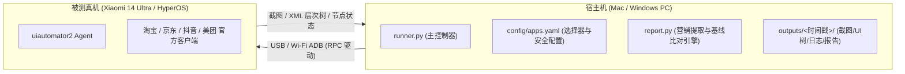

# 竞品 App 路径巡检系统 (Xiaomi 14 Ultra 真机适配)

这是一个面向电商与本地生活四大平台（**淘宝、京东、抖音、美团**）的自动化体验与营销情报巡检系统。
通过在 Mac/PC 宿主机上运行控制器，经由 ADB / `uiautomator2` 自动化驱动连接的小米14 Ultra（HyperOS / Android 14+）真机，执行端到端的业务体验路径：
**启动 App → 清理弹窗 → 搜索目标商品 → 过滤并进入商品详情 → 深度提取营销与优惠信息（优惠券/满减/红包/会员/大促/银行卡优惠） → 确认规格(SKU)并安全推进至结算/支付方式选择页 → 触发收银台/银行卡页面特征时立即主动停止。**

---

## 架构与被测环境说明

> [!IMPORTANT]
> **宿主机与被测手机职责分离**：
> - **宿主机 (Host Controller)**：您的 **Mac (macOS)** 或 **PC (Windows)**。脚本 `runner.py` 与 `report.py` 在宿主机运行，负责下发指令、接收截图、解析 UI 树 XML、比对基线并生成报告。手机端**无需**提前编译打包项目代码。
> - **被测设备 (Device Under Test, DUT)**：**小米14 Ultra 真机**（运行 Xiaomi HyperOS，基于 Android 14+）。手机作为受测终端，仅运行标准的各平台官方 App 与 `uiautomator2` 底层驱动 RPC Agent。



---

## 绝对安全底线 (Zero Payment Risk)

系统在架构与代码层面设立了严格的安全防线，确保**零真实资金风险**：
1. **收银台/支付方式页立即终止**：一旦检测到收银台、选择支付方式、银行卡列表等特征关键词，立即完成最终快照捕获并正常退出。
2. **绝对禁止点击支付提交按钮**：内置 `prohibited_action_texts` 熔断机制，严禁点击 `提交订单`、`立即支付`、`确认支付`、`立即付款`、`去支付`、`开通并支付`、`极速支付`、`免密支付` 等可能产生实际扣款的按钮。若元素文案或候选词命中禁止项，执行器将触发安全异常并拒绝点击。
3. **绝不输入任何支付凭据**：绝不输入银行卡号、CVV、有效期、短信验证码、交易密码或个人凭据。一旦界面出现卡号或 CVV 输入框，立即中止。
4. **绝不绕过登录与风控**：遇到账号登录、短信登录、滑动拼图验证码、人机验证或风控拦截界面时，立即捕获证据并安全停下，绝不尝试破解或绕过保护。

---

## 小米14 Ultra (HyperOS) 与真机环境准备

### 1. 手机端设置（关键：小米安全限制）
1. **开启开发者选项**：打开手机【设置】->【我的设备】->【全部参数与信息】，连续点击【OS 版本】7 次，直至提示“您现在处于开发者模式”。
2. **开启调试权限（重要）**：
   - 进入【设置】->【更多设置】->【开发者选项】。
   - 打开 **【USB 调试】**。
   - **必须打开【USB 调试（安全设置）】**（允许通过 USB 模拟点击和按键输入；开启时小米系统会进行 3 次 5 秒安全确认，手机需插入 SIM 卡并登录小米账号）。
   - 打开 **【USB 安装】**。
   - 打开 **【不锁定屏幕】**（充电时屏幕不休眠，防止自动化中断）。
3. **连接授权**：使用原装数据线将小米14 Ultra 连接至 Mac/PC，手机端弹出“允许 USB 调试吗？”，勾选“一律允许使用这台计算机进行调试”并点击【确定】。
4. **提前登录 App**：在手机上提前手动登录**淘宝、京东、抖音、美团**账号，并完成基础权限授权（通知/存储等），确保处于正常已登录可用状态。

### 2. 宿主机 (Mac / PC) 环境配置
- **安装 ADB (Android Platform Tools)**：
  - **macOS**：
    ```bash
    brew install android-platform-tools
    ```
    *(若未安装 Homebrew，可直接下载 Google 官方 Platform-Tools 并将其解压路径加入 `$PATH`)*
  - **Windows**：
    下载 [Android SDK Platform-Tools for Windows](https://developer.android.com/tools/releases/platform-tools)，解压后将包含 `adb.exe` 的文件夹路径添加到系统的【环境变量】`Path` 中。
- **验证设备连接**：
  ```bash
  adb devices
  ```
  终端输出应显示形如：
  ```text
  List of devices attached
  24030PN60C    device
  ```
  *(若显示 `unauthorized`，请点亮手机屏幕并在弹出提示中点击【允许】)*

---

## 快速安装与运行

为了减少首次运行步骤，macOS 可以直接执行：

```bash
cd /path/to/competitor-app-inspector
brew install android-platform-tools   # 只需执行一次
./bootstrap_mac.sh                     # 自动创建 .venv 并安装依赖
./.venv/bin/python preflight.py         # 检查依赖、ADB、手机和四个 App
./run_inspection.sh --app taobao --query "洗衣液"
```

如果没有 Homebrew，项目也支持使用项目目录内的 Android platform-tools；初始化脚本会显示实际 ADB 路径，运行脚本会自动优先使用它。直接执行 `preflight.py` 时请使用虚拟环境解释器，或直接使用 `run_inspection.sh`。

如果手机还没有连接，安装完成后可用 `./preflight.py --allow-no-device` 只检查 Python 依赖。`run_inspection.sh` 会在缺少虚拟环境时自动安装依赖，但仍会在没有真机时停止，避免产生空报告。

### 1. 搭建 Python 虚拟环境并安装依赖
```bash
# 宿主机上进入项目根目录
cd /path/to/competitor-app-inspector

# 创建 Python 3.9+ 虚拟环境
python3 -m venv .venv
source .venv/bin/activate    # Windows 环境请使用: .venv\Scripts\activate

# 安装依赖 (uiautomator2, PyYAML, Pillow)
pip install -r requirements.txt
```

### 2. 执行巡检
```bash
# 统一对四个 App 巡检搜索“洗衣液”
python runner.py --query "洗衣液"

# 或指定 ADB 设备序列号（多设备连接时使用）
python runner.py --serial 24030PN60C --query "洗衣液"

# 或单独巡检单个 App (如 taobao, jd, douyin, meituan)
python runner.py --app taobao --query "运动鞋"
```

运行输出均归档在 `outputs/<YYYYMMDD_HHMMSS>/` 目录下，包含：
- `device_env.json`：小米14 Ultra 真机与宿主机软硬件详细参数（HyperOS 版本、Android API、屏幕分辨率、DPI、电量状态、已装 App 版本等）。
- `report.md`：富文本 Markdown 巡检报告。
- `report.json`：结构化运行总结数据。
- `<App名称>/`：每一步的高清截图 (`.png`)、标准 UI 层次树 (`.xml`)、结构化事件流 (`actions.jsonl`) 与易读操作流水日志 (`execution.log`)。

首次执行建议先单独跑淘宝，确认一条路径成功后再跑四个 App：

```bash
./run_inspection.sh --app taobao --query "洗衣液"
./run_inspection.sh --query "洗衣液"
```

### 3. Baseline (基线) 差异比对运行
将某次稳定巡检输出目录另存为基线库（如 `baseline/`）：
```bash
cp -r outputs/20261019_235000 baseline
```
后续执行巡检时传入 `--baseline` 参数：
```bash
python runner.py --query "洗衣液" --baseline baseline
```
报告中将自动输出 **Baseline 差异对比分析**：
- **视觉画面变动**：基于 Pillow 感知哈希 (dHash) 自动计算页面图像相似度百分比与 SHA256 对比。
- **UI 文本变动**：清晰列出与基线相比新增与消失的页面文案。
- **营销活动演进**：对比列出新增上线的优惠券/满减活动，以及已下线的失效优惠。

### 4. 离线重新生成报告 (无需连接手机)
```bash
python report.py outputs/20261019_235000 --baseline baseline --query "洗衣液"
```

---

## 定时运行与无人值守说明 (Scheduled Automation)

若需在夜间或固定周期（如每日早 9:00、大促前后）自动执行巡检，可使用以下配置：

### 1. macOS 定时任务

#### 方案 A：使用 Crontab
编辑当前用户任务：`crontab -e`
```cron
# 每天早上 09:00 自动巡检并对比 baseline
0 9 * * * cd /path/to/competitor-app-inspector && /path/to/competitor-app-inspector/.venv/bin/python runner.py --query "洗衣液" --baseline baseline >> cron_inspection.log 2>&1
```

#### 方案 B：使用 macOS 原生 `launchd` (推荐，支持合盖唤醒与精准调度)
创建配置文件 `~/Library/LaunchAgents/com.competitor.inspector.plist`：
```xml
<?xml version="1.0" encoding="UTF-8"?>
<!DOCTYPE plist PUBLIC "-//Apple//DTD PLIST 1.0//EN" "http://www.apple.com/DTDs/PropertyList-1.0.dtd">
<plist version="1.0">
<dict>
    <key>Label</key>
    <string>com.competitor.inspector</string>
    <key>WorkingDirectory</key>
    <string>/path/to/competitor-app-inspector</string>
    <key>ProgramArguments</key>
    <array>
        <string>/path/to/competitor-app-inspector/.venv/bin/python</string>
        <string>runner.py</string>
        <string>--query</string>
        <string>洗衣液</string>
        <string>--baseline</string>
        <string>baseline</string>
    </array>
    <key>StartCalendarInterval</key>
    <dict>
        <key>Hour</key>
        <integer>9</integer>
        <key>Minute</key>
        <integer>0</integer>
    </dict>
    <key>StandardOutPath</key>
    <string>/path/to/competitor-app-inspector/outputs/launchd_stdout.log</string>
    <key>StandardErrorPath</key>
    <string>/path/to/competitor-app-inspector/outputs/launchd_stderr.log</string>
</dict>
</plist>
```
加载任务：
```bash
launchctl load ~/Library/LaunchAgents/com.competitor.inspector.plist
```

### 2. Windows 定时任务 (Task Scheduler)
在 Windows PC 上，创建 `run_task.bat`：
```bat
@echo off
cd /d C:\path\to\ni-ha
call .venv\Scripts\activate
python runner.py --query "洗衣液" --baseline baseline >> task.log 2>&1
```
使用 `schtasks` 命令注册每日运行任务：
```cmd
schtasks /create /tn "AppPathInspection" /tr "C:\path\to\ni-ha\run_task.bat" /sc daily /st 09:00
```

### 3. 定时自动化重要注意事项
- **USB 供电稳定**：确保手机通过带供电功能的 USB 口常连宿主机。
- **屏幕常亮保活**：必须保持手机【开发者选项】中的【不锁定屏幕】开启，或在巡检前由脚本执行唤醒命令。
- **免密支付防范**：日常巡检账号**强烈建议关闭系统内的“极速免密支付”**，作为除脚本熔断层之外的双重兜底。

---

## 选择器 (Selector) 调整与维护手册

各大电商与本地生活平台客户端（尤其是淘宝和美团）界面迭代频繁，且存在多变的分流 A/B 实验。如果巡检在某一步骤提示 `找不到搜索框`、`找不到购买入口按钮` 或 `找不到商品卡片`，请按下述指南快速维护：

### 1. 如何查看当前真实界面的 UI 元素与属性？
在巡检失败时，对应步骤目录下已自动保存了当前界面的 `.xml` 层次树文件（例如 `outputs/.../淘宝/04_product_detail.xml`）。
您可直接：
1. **查阅 XML 文件**：使用文本编辑器搜索页面上看到的按钮文字（如“领券购买”），查看其 `resource-id`、`text`、`content-desc` 或父节点的 `class`。
2. **可视化检查工具 (weditor)**：
   ```bash
   pip install weditor
   python -m weditor
   ```
   浏览器将自动打开可视化 UI 审查界面，手机连接后即可直观点击审查各节点选择器。

### 2. `config/apps.yaml` 各配置段调整说明

```yaml
defaults:
  prohibited_action_texts: # 严禁点击的高危文案列表，只要文本包含该项绝对拒绝点击
    - 提交订单
    - 立即支付
    - 确认支付
    - 去支付
    - 开通并支付
  
  payment_stop_texts:      # 到达支付方式页/收银台的特征文案，检测到立即停止
    - 收银台
    - 支付方式
    - 银行卡
    - 花呗分期
    - 云闪付

apps:
  taobao:
    display_name: 淘宝
    package: com.taobao.taobao
    # 1. 首页搜索框入口：若淘宝改版更换了搜索框文案或 id，在此追加
    search_entry_texts: [搜索, 搜索商品, 输入你想要的, 寻找宝贝店铺]
    search_entry_ids: [com.taobao.taobao:id/home_searchedit, com.taobao.taobao:id/searchbox]
    
    # 2. 详情页购买按钮：支持多种营销态按钮文案
    buy_texts: [立即购买, 领券购买, 马上抢, 购买]
    
    # 3. 规格/SKU 弹层确认按钮：点击购买后通常弹出规格浮层，点击确定进入下一步
    sku_confirm_texts: [确定, 立即购买, 下一步]
    
    # 4. 结算页入口：绝对不可配置“提交订单”！
    checkout_entry_texts: [去结算, 结算]
    
    # 5. 支付方式行特征：在确认订单页用于定位支付方式展示区
    payment_entry_texts: [支付方式, 付款方式, 银行卡, 收银台]
```

### 3. 各平台常见文案漂移与应对技巧
- **淘宝**：搜索结果列表中可能穿插直播间（“直播中”）与广告推广（“广告”），系统内置启发式过滤，优先选取包含 `¥` 价格符号的内容卡片。
- **抖音**：搜索默认进入“综合”流，容易点进短视频。配置中的 `search_tab_texts: [商品]` 会自动点击切换至纯商品卡片 Tab。
- **京东**：百亿补贴商品可能显示“立即补贴”或“抢购”，将其加入对应 app 的 `buy_texts` 即可。
- **美团**：外卖/买菜/团购详情页按钮通常为“去结算”或“去买单”，已内置在 `buy_texts` 中。

---

## 项目文件结构

```text
├── config/
│   └── apps.yaml         # 四款 App 包名、各步骤候选选择器、营销分类词典与安全拦截名单
├── runner.py             # 宿主机主程序：设备握手、环境采集、弹窗治理、安全路径巡检
├── report.py             # 报告生成与基线比对引擎：XML 上下文提取、dHash 视觉哈希、报告渲染
├── preflight.py          # 运行前检查：Python 依赖、ADB、真机和 App 包名
├── bootstrap_mac.sh      # macOS 一键创建虚拟环境并安装依赖
├── run_inspection.sh     # 一键预检并启动巡检
├── requirements.txt      # 依赖声明 (uiautomator2, PyYAML, Pillow)
├── README.md             # 本技术手册与操作指南
├── outputs/              # 巡检产物目录 (按 YYYYMMDD_HHMMSS 归档)
└── baseline/             # 历史基线比对目录 (可选)
```
