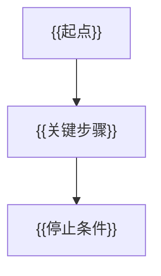

<!-- evidence_mode: template -->

# {{报告标题}}

> 使用前先选证据模式。没有当次截图和 UI 树时，把首行注释改成 `synthetic`，并在标题下写明「合成演示 / 非实测」。有可追溯产物时改成 `measured`，写明「证据模式：实测」。不得伪造版本、界面、转化率、样本量或收益。占位符 `{{` 必须替换掉，正式报告才能通过校验。

主张标记：【事实】【推断】【建议】【待验证】【缺失】【合成】。事实只写索引里有的材料。缺失保持【缺失】。

## 结论

用一段话说清业务问题：谁要在什么情境里做完哪件事，观察停在哪一步。

三条以内的判断，每条标明主张类型：

1. {{判断一}}
2. {{判断二}}
3. {{判断三}}

## 分析对象与可比性

| 项目 | 内容 |
| :--- | :--- |
| 旅程 | {{只选一条，例如搜索到结算预览}} |
| 业务问题 | {{}} |
| 人群 / 任务 / 情境 | {{}} |
| 版本 / 平台 | {{}} |
| 采集时间 | {{}} |
| 账号状态 | {{}} |
| 实验组 | {{没有记录就写【缺失】}} |
| 可比对象 | {{同一任务上可以对照的机制}} |
| 不可比项 | {{不同商业模式、不同入口}} |
| 北极星口径 | {{只写定义和方向，不写目标数字}} |
| 稳定基线 | {{有基线才填；否则【缺失】}} |
| 本期变化 | {{只写已复核的差异；没有基线就不写改版}} |



## 证据索引

| ID | 类型 | 来源 | 时间 | 复现条件 | 截图或文件路径 | 置信度 | 限制 |
| :--- | :--- | :--- | :--- | :--- | :--- | :--- | :--- |
| {{证据ID}} | {{事实或合成}} | {{}} | {{}} | {{}} | {{}} | {{高 / 中 / 低 / 不适用}} | {{}} |

没有路径的行不要写成事实。真实产物的编号使用 `EVD-`。合成材料使用 `SYN-`，并在类型列写明合成。

## 重点问题

只保留证据撑得住的问题。下面三条是骨架，不够就删，不要为了凑数加问题。每条都要回答：这个设计为什么存在，什么情况下不该抄。

### 问题一：{{标题}}

**证据引用**

{{证据ID}}。写明是仓库事实、当次产物还是合成。

**观察**

只写材料里看得到的布局、文案、状态和数字。没有的部分标【缺失】。

**设计机制**

【推断】这个设计把什么成本从谁转给谁。避免只写「更清晰」或「更顺」。

**用户成本**

谁付出时间、钱、理解或信任。写出情境，而不是全体用户。

**业务收益与代价**

可能多得到什么，可能损失什么。只写口径，不写承诺。

**适用边界**

什么业务模型、什么品类、什么账号状态下，这条建议不成立。给出一个反例。

**建议**

改前：

```text
{{改前线框或流程}}
```

改后：

```text
{{改后线框或流程}}
```

**验证方案**

- 假设：{{}}
- 主指标口径：{{}}
- 护栏口径：{{}}
- 事件：{{}}
- 分群：{{}}
- 负向影响：{{}}
- 停止与回滚：{{}}
- 样本量 / 周期 / 阈值：【缺失】除非已有真实基线及来源

### 问题二：{{标题}}

**证据引用**

{{证据ID}}

**观察**

{{}}

**设计机制**

{{}}

**用户成本**

{{}}

**业务收益与代价**

{{}}

**适用边界**

{{}}

**建议**

{{}}

**验证方案**

{{}} 样本量【缺失】则保持缺失。

### 问题三：{{标题}}

**证据引用**

{{证据ID}}

**观察**

{{}}

**设计机制**

{{}}

**用户成本**

{{}}

**业务收益与代价**

{{}}

**适用边界**

{{}}

**建议**

{{}}

**验证方案**

{{}}

## 对比与维度取舍

先列候选维度，再删掉没有证据的项。不要为了表的完整度保留空行结论。

| 维度 | 纳入或排除 | 原因 |
| :--- | :--- | :--- |
| {{维度}} | {{}} | {{}} |

| 比较点 | {{对象 A}} | {{对象 B}} | 用法 |
| :--- | :--- | :--- | :--- |
| {{}} | {{}} | {{}} | {{只对照机制，不打总分}} |

代表性步骤逐点拆解。有真实截图才放图，并在索引里给出路径。否则使用文字线框。

| 元素 | 层级与文案 | 状态 | 和任务的关系 |
| :--- | :--- | :--- | :--- |
| {{}} | {{}} | {{}} | {{}} |

## 建议、取舍与实验

按影响、证据强度、成本排序。证据弱的项不能因为改动看起来大就放进 P0。

| 编号 | 动作 | 影响 | 证据强度 | 成本或风险 | 优先级 | 理由 |
| :--- | :--- | :--- | :--- | :--- | :--- | :--- |
| {{}} | {{}} | {{}} | {{}} | {{}} | P0 | {{}} |
| {{}} | {{}} | {{}} | {{}} | {{}} | P1 | {{}} |
| {{}} | {{}} | {{}} | {{}} | {{}} | P2 | {{}} |

短期方案：{{}}

中期方案：{{}}

验收标准：{{}}

不做：

- {{不做项一：例如不打加权总分}}
- {{不做项二：例如不承诺转化收益}}
- {{不做项三：例如证据不足时不写视觉结论}}

## 自动巡检如何标记

写明这次运行的证据等级，以及下面哪些情况已经出现。出现则拒绝对应推断。

| 情况 | 本次是否出现 | 因此拒绝什么 |
| :--- | :--- | :--- |
| 登录或风控阻塞 | {{}} | 不比较登录后的页面 |
| 弹窗在截图前被点掉 | {{}} | 不描述弹窗外观；这是证据丢失 |
| 坐标兜底 | {{}} | 不把落点写成用户选择 |
| 支付泛词命中 | {{}} | 不断言已经进入收银台 |
| 没有基线 | {{}} | 不写本期变化 |
| 采集失败 | {{}} | 不把缺失步骤解释成产品没有该能力 |
| 实验分组未采集 | {{}} | 不把差异归因到 A/B |

等级规则以 `evidence.py` 为准。自动观察停在标记和原文差异。机制、代价和是否开专题，由人判断。

变化摘要留在日报。本模板只在决定开专题之后使用，不每天生成长文。

## 附录：方法、缺失与声明

方法：{{读了哪些文件，如何区分事实和推断}}

缺失：{{逐条列出，不补造}}

声明：{{若是合成演示，重申非实测，且不代表淘宝、京东、抖音、美团}}
