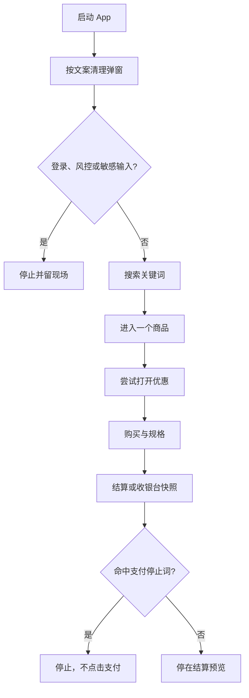
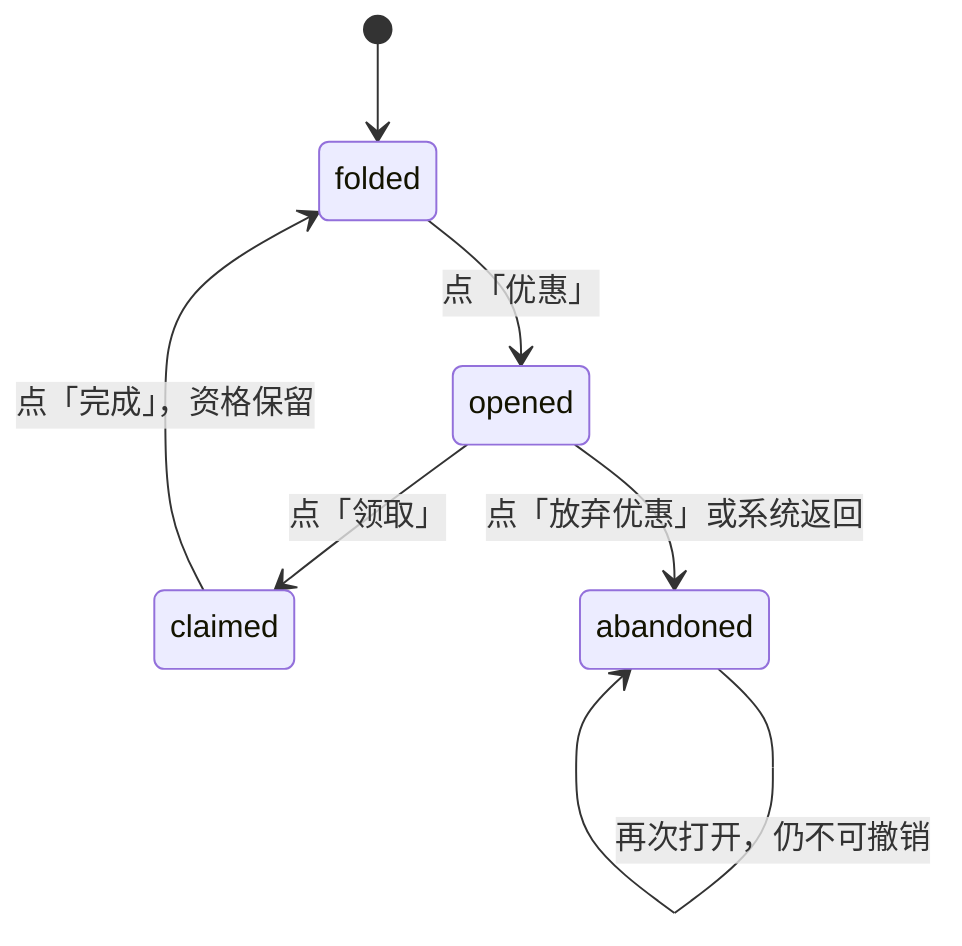

<!-- evidence_mode: synthetic -->
<!-- claim_policy: repo_facts_and_labeled_synthesis -->

# 洗衣液补货：从搜索到结算前的体验判断

> **文档性质：合成演示 / 非实测。** 本文件用于作品集、学习和报告模板校验。它不是淘宝、京东、抖音、美团的实测报告，也不能当作这四款产品的当前界面、版本或经营结果。

主张在文中用标记区分：

- 【事实】能指到本仓库文件的陈述。
- 【推断】由事实或合成观察推出的机制假设。
- 【建议】建议做的动作。
- 【待验证】还缺证据才能下的判断。
- 【缺失】仓库或合成设定都没有的数据，保持缺口。
- 【合成】为演示写法而构造的界面、人物和数字。

## 结论

这条旅程在仓库里被规定为：启动、处理弹窗、搜索、进入一个商品、查看优惠、走到结算预览，并在支付边界停止。【事实】规定写在 `runner.py` 的 `Inspector.run` 和 `config/apps.yaml`。仓库没有附带任何一次运行的截图、UI 树或基线，所以现在不能对四款已配置 App 的界面下体验结论。

若只把日报里的营销词和截图张数当成竞品分析，会得到一份功能清单。真正要判断的是：补货的人在支付之前，能不能确认「这个价格我现在拿得到」以及「这件东西什么时候用得上」。支付成功本身不在可观察范围内，因为工具按安全规则停在支付按钮之前。

三个判断：

1. 【事实】采集器有三处会污染这条旅程：弹窗可能在留证之前被点掉，其中包含「放弃优惠」和授权文案；「第一个商品」在四个包上不是同一种选择；支付停止词里有「支付宝」这类泛词。这三处不先处理，后面的竞品比较没有可比性。
2. 【合成】演示产品「澄市」把不可达成的会员价写成搜索结果的主价格，并把年费会员默认勾进结算。演示产品「邻时」把送达时间放在主层级，价格使用当前账号拿得到的门店价。两者卖的都是「洗衣液」，决策事实不同，不能打总分。
3. 【建议】本仓库的可执行项是把上述污染写进日报并停止过度推断，这一项已经落在证据等级里。弹窗点击策略和支付停止规则尚未改运行逻辑，因为「停下来等人」和「自动点掉」是产品取舍。澄市、邻时的界面建议只存在于演示队列。

## 分析对象与可比性

### 仓库里证据最充分的旅程

【事实】全仓库没有 `outputs/` 下的运行产物，`.gitignore` 也排除了 `outputs/` 和 `baseline/`。证据最充分的对象不是某一款 App 的界面，而是代码里的固定旅程。默认关键词是「洗衣液」。



【事实】启动后会先 `app_stop` 再打开，用来避开上一次留在详情或结算的任务栈，同时不清账号。抖音配置了额外的返回并重新打开。美团配置了跳过优惠展开。抖音和美团、京东都备有坐标兜底。淘宝这条配置走语义选择器，没有坐标点。

【事实】因此四个包虽然跑的是同一脚本，入口任务并不相同。货架搜索、内容流里的商品 Tab、到店或到家门店，被收成了「点到一个带价格的东西」。这是采集范围的选择，不是用户研究已经证明四个场景可以并列。

【缺失】四款 App 的当次版本号、账号是否登录、是否会员、城市、实验分组、真实截图、UI 树、转化率和收入。这些在本仓库中不存在，下文不补造。

### 为什么界面分析改用合成演示

【事实】没有截图和 UI 树，就没有视觉层级、组件状态和文案位置可以引用。若把常识里的电商界面写成「当前长这样」，会把记忆伪装成采集。

【合成】下文用两个虚构产品把同一条旅程写完，演示证据齐了之后应当写到什么粒度。合成时间定为 2026-11-01 21:10（+08:00），只用于固定情境，不是采集时间。版本号都是 `0.0.0-demo`。实验组未建模。

| 项目 | 澄市 | 邻时 |
| :--- | :--- | :--- |
| 是什么 | 虚构的全品类货架 | 虚构的附近门店即时送达 |
| 这条任务怎么赚钱 | 佣金、广告、会员订阅。价格数字参与抢点击 | 商品差价和配送。履约密度参与抢下单 |
| 合成人物要完成的事 | 买到洗衣液，价格自己算得清 | 买到今晚或明早用得上的洗衣液 |
| 不拿来比的东西 | 快递天数的绝对值 | 30 到 50 分钟的绝对值 |

【合成】人物林可，负责家里的日用品补货。周日 21:10，洗衣液只够洗一次，希望今晚或明早能用。已登录、非会员、地址已保存、购物车是空的。这不是访谈对象，没有录音或样本框。

【推断】这个人的限制是时间和工作记忆，不是「不会用手机」。建议若只写成「让流程更顺」，没有指出哪一种理解成本被哪一个经营目标转嫁，就还是空话。

### 北极星怎么选

【合成】澄市若把这条旅程当成经营对象，北极星用「价格被正确理解的结算预览次数」，不用支付 GMV。价格被正确理解，指结算应付与进入详情前的主价格一致，或者每一笔差额都来自用户主动确认的付费附带项。

【事实】这个口径是故意停在支付之前的。工具禁止点击提交和支付，真实支付转化在这套采集里本来就不可观察。【缺失】澄市没有真实基线，所以没有目标值，也没有「提升多少」可以承诺。

【合成】邻时在同一任务上的主事实是送达窗口。它的分解指标应先看「承诺窗口是否在搜索结果就被说清」，而不是先看谁的价格字更大。把澄市的价格层级抄到邻时，会把赶不上今晚这件事藏起来。

### 稳定基线与本期变化

【合成】澄市有两份演示稿，用来展示「稳定基线」和「本期变化」必须拆开写。

- S0，稳定基线稿：搜索卡同时写出当前可达成价和会员价；结算页的年费会员默认不勾选。
- S1，本期变化稿：搜索卡只留会员价；结算页把年费会员改成默认勾选。两处变化同时出现，验证时要拆成两个实验，不能合成一句「价格体验优化了」。

【合成】邻时在这两份稿之间没有价格资格上的变化。它参加比较，是因为同一任务、同一关键词、同一时间盒，不是因为它和澄市属于同一商业模式。

【事实】真实日报里的「变化」只来自同名步骤的文件哈希、dHash 相似度和 UI 文案集合，见 `report.py` 的 `compare_with_baseline`。相似度没有被标定成「低于某值就是改版」。【缺失】这个阈值。没有标定之前，相似度只用于把步骤排进人工复核队列。

## 证据索引

| ID | 类型 | 来源 | 时间 | 复现条件 | 路径 | 置信度 | 限制 |
| :--- | :--- | :--- | :--- | :--- | :--- | :--- | :--- |
| REPO-JOURNEY | 事实 | `Inspector.run` 的步骤顺序 | 随当前代码，无运行时刻 | 阅读函数，不需要手机 | `runner.py` | 高 | 这是脚本，不是某位用户的走查 |
| REPO-DISMISS | 事实 | 弹窗文案与点击循环 | 同上 | 阅读配置和 `dismiss_popups` | `config/apps.yaml`、`runner.py` | 高 | 不能证明线上弹窗的样子 |
| REPO-PAY | 事实 | `payment_stop_texts` 含「支付宝」等泛词；命中后停止 | 同上 | 阅读配置与 `payment_visible` | `config/apps.yaml`、`runner.py` | 高 | 子串命中不等于收银台 |
| REPO-COORD | 事实 | 抖音坐标注释写 1080x2400；README 目标机写 1440x3200 | 同上 | 对读两处文本 | `config/apps.yaml`、`README.md` | 高 | 没有坐标命中截图 |
| REPO-DIFF | 事实 | 基线对比使用哈希、dHash 和文案集合 | 同上 | 阅读 `compare_with_baseline` | `report.py` | 高 | 相似度不是改版结论 |
| REPO-EMPTY | 事实 | 仓库不提交运行产物 | 检查工作树与忽略规则 | 确认没有已跟踪的截图或基线 | `.gitignore` | 高 | 某人电脑上未提交的运行不在本结论内 |
| REPO-GRADE | 事实 | 日报按目录打证据等级 | 本次代码 | 对离线夹具运行单测 | `evidence.py`、`report.py` | 高 | 等级判断的是采集，不是体验好坏 |
| SYN-S0 | 合成 | 澄市基线稿的文字线框 | 合成设定 2026-11-01 | 不可在真机复现 | 本文件线框，无截图 | 不适用 | 禁止外推到真实 App |
| SYN-S1 | 合成 | 澄市本期稿的文字线框 | 同上 | 不可在真机复现 | 本文件线框，无截图 | 不适用 | 数字是为了把口径算平 |
| SYN-LIN | 合成 | 邻时同期文字线框 | 同上 | 不可在真机复现 | 本文件线框，无截图 | 不适用 | 时效数字不是行业基准 |
| SYN-PERSON | 合成 | 人物与情境 | 同上 | 无招募、无录音 | 无 | 不适用 | 不能写成用户研究 |

【缺失】真实竞品的截图路径、采集账号状态、实验桶、读屏记录、客诉样本、价格落差的方差。索引里留空，不发明文件名。

## 重点问题

三条都落在同一条旅程上：搜索结果的价格、优惠层的关闭、结算预览里的附带项。采集约束来自仓库；界面细节是合成演示。每条都按证据、观察、机制、成本、收益与代价、边界、建议、验证来写。

### 问题一：搜索结果把不可达成的低价写成了主事实

**证据引用**

【事实】REPO-EMPTY、REPO-JOURNEY。真实搜索结果长什么样，本仓库没有截图。【合成】SYN-S0、SYN-S1。下面的字号、颜色和金额只存在于演示稿。

**观察**

【合成】S1 的搜索卡把 `¥29.9` 放在卡片视觉终点，约为主价格角色，颜色使用品牌红。它下面只有「券后价」三个字。会员条件「开通后再减 ¥12」从 S0 的卡片次行，移到了详情页「优惠」折叠里的第二行，演示标注为灰色、字号约为主价格的四成。

【合成】结算明细可以算平，所以这里把数字写死在演示里，方便核对口径：

| 明细 | 金额 | S1 的默认状态 |
| :--- | ---: | :--- |
| 商品，已含全员可领的券 | 41.9 | 必选 |
| 年费会员 | 15 | 默认勾选 |
| 会员商品减免 | -12 | 依赖上一行 |
| 运费 | 0 | 演示设定为已过包邮门槛 |
| 应付 | 44.9 | 入口卡若只写 29.9，落差是 15 |

落差 15 来自会员费，不是运费。若用户取消会员，应付回到 41.9，入口卡上的 29.9 仍然拿不到。

【合成】邻时同期的搜索卡主数字是「约 35–50 分钟」，门店价 39 是次级信息，且就是当前账号的门店价，没有第二套会员价。

**设计机制**

【推断】澄市的搜索位同时吃自然点击和广告点击。主价格使用「最低可能价」，是在用视觉层级替经营目标做默认选择，不是字号没有对齐。会员是订阅收入，放在用户已经付出搜寻和选规格的成本之后，拒绝它需要一次额外动作。

【推断】S0 到 S1 是两处分开的选择：一处是决策点只留低价，一处是结算默认带上会员。它们可以互相加强，但原因不同，不能写成一次「视觉优化」。

**用户成本**

【合成】林可是非会员，晚上要结束这件事。S1 让她先记住 29.9，到结算看见 44.9。工作记忆要重算券、会员和会员费的顺序。返回后演示稿不保留已选规格，规格要重选一次。

【合成】灰色条件文案在演示标注里弱于正文。视弱用户收到的主事实就是 29.9。这里没有读屏录音，【缺失】辅助技术下的实际朗读顺序，所以不写「已经违反某条无障碍标准」。

**业务收益与代价**

【推断】可能增加的是搜索卡点击、会员模块曝光、开通点击。可能损失的是结算预览被关掉、价格投诉，以及下一次补货绕开这张卡。这些都是口径，不是实测结果。

【事实】自动日报若只抽取含「¥」的营销句，会把 29.9 记成一条价格事实，且不会记录「当前账号是否达得到」。这是采集词典的限度，见 `report.py` 的营销分类。

**适用边界**

【建议】全员自动到账、当前账号一定拿得到的券，用券后价做主价格是成立的。S1 不成立，是因为 29.9 还要先付 15 的会员费。

会员价和非会员价并列、并且标着「未开通」，就不适用「资格后置」这个判断。高客单、可以留到明天再比的商品，用户会打开详情核对，伤害的形式和周日晚上的补货不同，不能把本建议原样搬过去。

邻时不应该抄 S1。它的主扫描对象是时效，把低价放大，会藏起「赶不上今晚」。

**建议**

【建议】搜索卡只把当前账号拿得到的价格当作主价格，演示里叫「你的价格」。更低但有门槛的价格放在次行，带上资格状态，不用灰色小字单独承担条件。

结算应付高于入口主价格时，差额逐条列出，并给出「按入口价重找」的明确动作。返回后保留规格草稿。这是演示产品的改法，不是本仓库的开发项。

改前，S1 搜索卡：

```text
┌────────────────────────────┐
│ 洗衣液 3kg                  │
│ 店铺 · 月销 1万+             │
│                             │
│                  ¥29.9      │
│                  券后价      │
└────────────────────────────┘
详情折叠第二行：开通会员再减 ¥12
```

改后，把 S0 的资格信息留在决策点，并写成账号状态：

```text
┌────────────────────────────┐
│ 洗衣液 3kg                  │
│ 店铺 · 月销 1万+             │
│ 你的价格            ¥41.9   │
│ 会员价 ¥29.9 · 未开通        │
└────────────────────────────┘
```

**验证方案**

【待验证】假设：主价格改回「当前拿得到的价格」之后，结算应付与入口主价格的落差下降；用户主动勾选会员时，这笔会员费不计入落差。

主指标口径：同一次「搜索卡曝光 → 结算预览」里，`结算应付 − 入口主价格` 的用户中位数。主动勾选的会员费从差额中剔除。期望方向是中位数靠近 0。没有方向之外的目标值。

护栏口径：搜索结果点击率；会员开通率；带「价格不一致」标签的投诉占比。点击率和开通率下降，可能是这件事先接受的代价，要在实验登记时写明哪一个是护栏、哪一个允许下降。不事先写明，实验就会在「体验变清楚」和「订阅变少」之间临时改口。

事件：`search_card_price_impression`（可达成价、条件价、资格、账号会员状态）、`checkout_price_impression`（明细行、默认勾选项）、`checkout_preview_close`。实验分组字段必须一起记，否则无法和个性化推荐分开。

分群：会员与非会员；这次是否从搜索进入。推荐流不在本条结论里。

负向影响：广告点击和会员开通可能下降。

停止与回滚：价格投诉占比或结算预览关闭率相对实验前基线变差，且超过登记阈值，就回到 S0 的展示。阈值【缺失】。样本量【缺失】。周期【缺失】。三样都依赖真实基线的到达人数和方差，演示稿不估算。

### 问题二：关闭优惠层被写成「放弃」，并且没有撤销

**证据引用**

【事实】REPO-DISMISS。`dismiss_popup_texts` 含有「放弃优惠」「同意」「允许」「始终允许」「仅在使用中允许」。`dismiss_popups` 最多点三轮，发生在搜索之前。标准流程先点掉，再截 `02_after_dismiss_popups`，弹窗自身没有单独快照。

【合成】SYN-S1 把同一组词放进澄市的优惠层，用来演示产品状态机。这不是发现某款真实 App 使用了这句文案。

**观察**

【合成】澄市优惠层的关闭文案是「放弃优惠」。点击之后资格进入「已放弃」，再次打开仍是已放弃，没有撤销。系统返回键和这个按钮效果相同。「完成」只在已领取之后出现。

【合成】邻时的关闭是「关闭」，面板收起后，满减仍留在结算明细。关闭不改变资格。

【事实】若真实巡检点到「放弃优惠」，日志里只会留下被点的词。弹窗布局、插图和层级都没有证据。随后的详情和结算，也不能再当成「未被这次巡检改写的账号」。



上图是澄市 S1 的合成状态。`folded` 是收起，`opened` 是展开，`claimed` 是已领取，`abandoned` 是已放弃。邻时没有 `abandoned` 这条边，关闭只回到 `folded`。

**设计机制**

【推断】把「不想看说明」和「不要这项权益」收成一个按钮，用损失厌恶提高领取点击。用户要表达「我知道了」，却必须在语义上先拒绝一份利益。

【推断】采集器把「放弃优惠」放进弹窗清理，是为了让脚本继续往下走。这个选择优先了路径完成率，代价是账号状态和证据完整性。它和产品里用损失框架做关闭，是同一类动作语义问题，出现在两个不同的系统里。

**用户成本**

【合成】误触之后，林可失去的是这一单的资格，不是一层浮层。她没有撤销，只能接受更高的应付，或者整单重来。读屏若只朗读「放弃优惠」，关闭和拒绝听起来是同一件事。【缺失】真实读屏记录。

【事实】测试账号若被巡检点掉权益，之后所有「用户能看到什么优惠」的比较都混进了工具的副作用。这个成本由后续每一次比较承担。

**业务收益与代价**

【推断】产品侧可能换到更高的领取点击，代价是误放弃、投诉，以及不敢再点任何像关闭的东西。采集侧可能换到更高的路径完成率，代价是优惠证据丢失，以及把授权点掉。

**适用边界**

优惠还没发放、按钮写的是「关闭说明」、关闭后资格仍在，这个判断不适用。

两项优惠互斥、必须放弃其中一项时，文案要写明放弃的是哪一项，并允许回到选择。这时「放弃」是选择，不是总关闭按钮。

「跳过」「我知道了」「以后再说」仍然可以自动点，它们不改写资格。本判断针对的是权益和授权。

**建议**

【建议】产品演示：关闭和放弃分成两个动作。放弃指向具体权益，并在短时间内可撤销。撤销要有可见状态，而不是只靠返回键。演示参数可以先用一段短撤销窗口，窗口长短本身不是效果承诺。

【建议】本仓库：自动点击列表去掉「放弃优惠」和授权类文案。弹窗先截图，标签里带 `popup`，再决定点还是停。权限和权益弹窗默认停住，记成阻塞，而不是点「同意」或「允许」换取继续。这个运行逻辑本次没有改，原因见建议一节的取舍。

**验证方案**

【待验证】产品假设：关闭不再改变资格之后，优惠层被关掉的次数里，资格仍保留的比例上升；领取率允许下降，是否下降到不能接受，要事先写成护栏或允许的代价。

主指标口径：`关闭后面板资格仍在的次数 / 关闭次数`。护栏口径：领取点击率、结算预览到达率。

事件：`offer_sheet_open`、`offer_sheet_dismiss`（动作是关闭还是放弃）、`offer_state`（保留、已领、已放弃）、`offer_undo`。

【待验证】采集器假设：点击前都有成对的弹窗截图和 UI 树；运行前后，测试账号的优惠状态不被脚本改变。后者需要账号侧的独立核对，仓库里没有这种核对记录，【缺失】核对方式的现成数据。

样本量、周期、停止阈值都【缺失】。没有历史「弹窗阻塞占比」，就不能写「先跑两周」。停止规则只先写定性：护栏越过登记阈值，就停在弹窗并标记阻塞，不把「放弃优惠」加回自动点击。

### 问题三：结算页的默认会员，和过宽的支付停止线互相掩盖

**证据引用**

【事实】REPO-PAY。支付停止词包含「收银台」「支付方式」，也包含「支付宝」「银行卡」「花呗」「白条」等更泛的词。`payment_visible` 用子串匹配，命中即停。

【合成】SYN-S1。澄市结算预览在同一屏放了默认勾选的年费会员，和一行「支付宝」字样。邻时的主按钮在未达起送价时是禁用态。两份都是文字线框，没有截图文件。

**观察**

【合成】澄市 S1 的会员行和商品行同一层级，行尾是一枚小复选框，默认选中。选中态靠颜色区分，旁边没有「已选中，将增加 ¥15」的文字。主按钮写「去支付」，金额 44.9。工具若在这里命中「支付宝」，日报的停止原因是支付边界，会员是否默认勾选不会写进停止原因。

【合成】邻时商品 39，起送价 45，差 6 才起送。配送费 6 在未起送时不收。主按钮是禁用的「差 ¥6 起送」，不是一个看起来能支付的按钮。关闭优惠不会改这组数字。

【事实】日报现在会把泛词命中标成「只可描述采集标记」，并拒绝「已经进入收银台」这句断言。它仍然不会自动识别默认勾选。默勾是结构问题，要人看结算页的成对截图和 UI 树。

**设计机制**

【推断】默认勾选把附带销售从「要不要」改成「去取消」。取消控件做得越小，拒绝成本越高。这和问题一的低价是配套的：入口用 29.9 把人带进来，结算用默认会员解释为什么应付不是 29.9。

【推断】禁用的主按钮把「还不能买」放在主动作上，商家少了一次附带收入，用户少了一次误支付。邻时选择先满足起送，再谈支付。这是履约模型里的门槛，不是按钮样式的偏好。

【事实】采集器的停止线优先避免真的付出去。这个优先级是对的。它的副作用是：停止原因会盖住停止前最后一屏里的默认项。深度专题必须把「为何停止」和「停止前一屏有什么结构」分成两句。

**用户成本**

【合成】林可若没有看见复选框，会为会员付 15，同时以为自己买到了 29.9 的洗衣液。她要撤销整笔附带，而演示稿里的复选框没有文字状态。

【事实】分析者若只读「已在支付页安全停止」，会漏掉默勾，也会把出现过「支付宝」三个字的普通页面当成收银台。两条误读的成本都是错误的竞品结论。

**业务收益与代价**

【推断】默勾可能提高会员开通，代价是被动扣费投诉，以及用户下一次不信任结算明细。禁用起送按钮可能降低冲动支付，代价是凑单步骤变长。

【缺失】投诉率和凑单完成率。不写数字。

**适用边界**

【待验证】默认勾选付费项在不同监管要求下是否允许，本文件不引用法条作结论。价格为 0 的赠品、并且一眼能看出是赠品，不属于本条所说的默勾。

支付停止词改窄之后，脚本会在更多页面上继续走。继续走必须仍然禁止点击「去支付」「提交订单」。改停止词不是为了把旅程推进到支付。

**建议**

【建议】演示产品：付费附带默认不选。选中后出现文字「已增加年费会员 ¥15」，不只靠颜色。主按钮上的金额和明细合计使用同一口径。未达门槛时，主按钮保持禁用并写出差多少，不伪装成支付。

【建议】本仓库：泛词命中维持停止，但日报继续标成低特异性。中期若改规则，页面类型要同时看标题和多个支付结构，而不是单靠「支付宝」四个字。结算全页快照在停止前保留。本次没有改停止词。

改前，S1 结算主区：

```text
洗衣液 3kg                         41.9
[已勾选] 开通年费会员，本单回本       15
会员商品减免                        -12
应付                               44.9
[ 去支付 44.9 ]          支付宝 >
```

改后：

```text
洗衣液 3kg                         41.9
[未勾选] 年费会员 ¥15，勾选后本单商品减 ¥12
应付                               41.9
[ 去支付 41.9 ]
```

邻时保持现在的演示逻辑即可，不需要改成澄市的支付按钮：

```text
门店价                             39
起送差 6，配送费未计
[ 差 ¥6 起送 ]（禁用）
```

**验证方案**

【待验证】假设：默勾改为不选之后，结算明细里「未经主动确认的付费附带金额」下降；会员开通率允许变化，但是否作为护栏要事先登记。

主指标口径：默认带上的付费附带金额占结算预览次数的比例。主动勾选不计入分子。

护栏口径：结算预览关闭率、会员开通率、支付前返回率。

事件：`addon_default_state`、`addon_toggle`、`checkout_total`、`primary_button_state`（可支付或禁用及原因）。停止采集的事件继续用现有 `result`，并保留命中的原文，供人判断是不是泛词。

分群：新会员资格与已是会员。已是会员不应再看到年费默勾，若看到，是另一类错误。

负向影响：订阅收入可能下降。这可以是接受的代价，也可以是停止实验的护栏，二者只能选一个角色。

停止与回滚：被动付费投诉或结算关闭率越过登记阈值，就回到默认不选，而不是回到默勾。阈值、样本量、周期【缺失】。

## 对比与维度取舍

维度按「会不会改变这条旅程上的决定」来选。凑满清单会把没有证据的项写成空话，所以下面明确写出不分析什么。

| 维度 | 是否纳入 | 原因 |
| :--- | :--- | :--- |
| 任务、情境、账号与实验组 | 纳入 | 没有这些，价格和时效无法比较 |
| 北极星及分解口径 | 纳入 | 用来限制团队不去优化看不见的支付 |
| 价格资格与视觉层级 | 纳入 | 问题一，有合成线框 |
| 优惠状态机、撤销 | 纳入 | 问题二 |
| 结算附带、主按钮状态 | 纳入 | 问题三 |
| 信息架构全站 | 不纳入 | 只走了搜索到结算前，没有首页信息架构的证据 |
| 品牌美观评分 | 不纳入 | 没有评分锚点，打分会伪装成测量 |
| 无障碍符合性结论 | 不纳入 | 【缺失】读屏和取色记录。只保留验收要求 |
| 留存曲线、支付转化 | 不纳入 | 【缺失】，且支付被安全规则排除在观察之外 |
| 内容流种草效率 | 不纳入 | 入口不是这次的搜索任务 |
| 四套商业模式加权总分 | 不纳入 | 没有公开的权重锚点，履约形态也不可比 |

| 比较点 | 澄市 S1（合成） | 邻时（合成） | 怎么用这个比较 |
| :--- | :--- | :--- | :--- |
| 搜索卡的主事实 | 29.9，无资格 | 35–50 分钟，价格为次级 | 看各自把什么放进前注意，不比谁更高级 |
| 主价格能否当场达成 | 不能，除非开通会员并另付 15 | 能，39 就是门店价 | 只评价澄市是否自洽 |
| 优惠层关闭 | 等于放弃，且不可撤销 | 等于收起，资格保留 | 状态机可以对照 |
| 结算主按钮 | 看起来能支付，金额含默勾 | 差 6 起送，禁用 | 主动作是否说出障碍 |
| 快递天数与分钟数 | 不参与评分 | 不参与评分 | 商业模式不同 |
| 实验分组 | 未建模 | 未建模 | 不能归因到 A/B |

### 代表性步骤逐点拆解

没有真实截图，所以用文字线框逐点写。每一行都是【合成】。

搜索卡，澄市 S1：

| 元素 | 位置与层级 | 和任务的关系 | 状态 |
| :--- | :--- | :--- | :--- |
| 标题「洗衣液 3kg」 | 左上，两行上限 | 确认是不是这件补货 | 静态 |
| 月销 | 标题下，灰色 | 别人买过，不回答「我能否拿到这个价」 | 静态 |
| ¥29.9 | 右下，最大、品牌红 | 被编码成这张卡的结论 | 没有悬停；无资格态 |
| 「券后价」 | 价格下，小字 | 暗示价已算完，实际仍差会员资格 | 静态 |
| 会员条件 | 不在这张卡上 | 决策点缺失 | 要进详情折叠才看得到 |

结算预览，澄市 S1，在问题三的改前线框上补状态：

| 元素 | 默认 | 用户取消勾选后 | 工具若命中「支付宝」 |
| :--- | :--- | :--- | :--- |
| 会员复选框 | 选中，无文字状态 | 未选中 | 停止原因不记录这一行 |
| 应付 | 44.9 | 41.9 | 日报不一定保留两套金额 |
| 主按钮 | 去支付 | 去支付，金额应跟着变 | 禁止点击。演示里也不点击 |

邻时搜索卡只有一个需要拆的点：主数字是时间窗口，价格不抢层级。把它改成大红价格，会直接破坏这套信息架构，所以「学习澄市的价格字号」不是可迁移建议。

## 建议、取舍与实验

排序看三件事：对判断或对用户的影响、证据强度、做错的代价。合成建议单独成队，不和本仓库的改造混成一个待办列表。证据强度为「合成演示」的项，不能因为写得具体就升到真实 P0。

### 本仓库队列

| 编号 | 动作 | 影响 | 证据强度 | 成本或风险 | 优先级 | 理由 |
| :--- | :--- | :--- | :--- | :--- | :--- | :--- |
| R1 | 日报标证据等级；缺机型不填目标设备；深度报告走契约校验 | 阻止把坏证据写成体验结论 | 高，代码和单测 | 低。不改变点击 | P0 | 没有这个闸门，后面的比较都会被污染。本次已做 |
| R2 | 弹窗先截图；自动点击去掉「放弃优惠」和授权文案；这类弹窗改为阻塞 | 保住账号权益，留下弹窗证据 | 高，配置和代码可指认 | 中。权限弹窗会让当次巡检停住 | P0 | 影响真实账号。本次不改运行逻辑，因为「停」还是「点」要负责人确认 |
| R3 | 坐标必须写明分辨率；未复核的点继续在日报降级 | 避免把坐标落点写成用户选择 | 高，两套分辨率文本互相矛盾；无命中截图 | 中。删掉坐标会让画布页面直接失败 | P1 | 降级已经做了。删坐标需要真机复核，本次不做 |
| R4 | 支付停止从泛词改为页面级结构，停止前保留结算全页 | 少把普通页面当成收银台 | 中高。泛词列表是事实；误停频率【缺失】 | 中。改窄之后脚本会走得更远，必须仍禁止支付点击 | P2 | 先靠日报标记降低误读。改规则要有真实误停样本 |

R2 的验收：

- 自动点击列表中不再出现「放弃优惠」「同意」「允许」「始终允许」「仅在使用中允许」。
- 若仍自动点击「跳过」「我知道了」，点击前的快照标签包含 `popup`，且截图与 UI 树成对。
- 遇到授权或权益文案时，`result.status` 表达阻塞，而不是点掉后继续搜索。
- 离线测试覆盖上述词表，不连接手机。

R2 的短期方案是先维持现状、用日报把风险标红。中期方案才是改点击策略。短期不是「先优化文案」，因为问题在动作语义，不在同义词。

### 演示产品队列

这些项的证据强度都是合成演示。它们展示一份产品建议应当长什么样，不进入本仓库排期。

| 编号 | 动作 | 影响 | 证据强度 | 成本或风险 | 优先级 | 理由 |
| :--- | :--- | :--- | :--- | :--- | :--- | :--- |
| D1 | 搜索卡主价格改为当前账号可达成价，门槛价降为带状态的次行 | 减少结算落差 | 合成 | 点击和会员曝光可能下降 | P0 | 落差发生在决策点，且和默勾互相加强 |
| D2 | 关闭与放弃分离，放弃可撤销 | 误触不再丢资格 | 合成 | 领取率可能下降 | P1 | 状态机错误明确，但伤害发生在用户主动打开优惠之后 |
| D3 | 付费附带默认不选，主按钮金额与明细一致；未达门槛则禁用并说明差额 | 减少被动付费 | 合成 | 订阅收入可能下降 | P2 | 依赖 D1 先把入口价说清。两件一起改会无法归因 |

D1 改前改后线框见问题一，D3 见问题三。D2 的流程对照：

```text
改前：点优惠 → 只能「领取」或「放弃优惠」 → 放弃不可撤销
改后：点优惠 → 「领取」或「关闭」；关闭后资格仍在
      若要放弃某一张券 → 单独入口，确认，短时撤销，状态可见
```

### 实验登记时必须分开的角色

【建议】会员开通率不能同时当「希望它涨」的成功标准和「跌了就停」的护栏。澄市演示里，把它登记为允许下降的代价，护栏改用价格投诉和结算预览关闭率。若业务负责人认为订阅不能降，就不要做 D1，而不是做完再改口径。

【缺失】所有实验的样本量、周期、方差和阈值。真实基线不存在。演示不提供「至少多少人」。

### 明确不做

- 不做四款真实 App 的加权评分，也不给澄市、邻时打总分。
- 不把合成线框配上真实产品的名字重新发出去。
- 不在没有截图和 UI 树时写视觉结论。不使用图片占位冒充采集。
- 不把日报自动扩成每日长文。有变化线索才人工开专题。
- 不在样本量缺失时写实验周期或承诺收益。
- 不为了把路径跑完，去点击「提交订单」「去支付」，也不绕过登录。
- 不在本次改动里删除坐标或放宽支付禁止词。没有真机复核之前，改变点击行为会制造新的不可比。

## 自动巡检如何标记

日报第五节由 `evidence.py` 生成。它只读已经落下的文件和 `actions.jsonl`，不连接设备，不把 UI 原文抄进证据等级，避免把昵称再写一遍。

| 标记 | 看到什么 | 允许的推断 | 拒绝的推断 |
| :--- | :--- | :--- | :--- |
| 采集失败 | `result.status` 为 error，或没有权威结果却有 error | 失败停在哪一步 | 没走到的步骤说明产品没有该能力 |
| 登录或风控阻塞 | 状态以 `stopped_login` 开头 | 描述阻塞现场 | 比较登录之后的页面，猜测实验分组 |
| 弹窗外观未留存 | 有 `dismiss_popup`，且没有标签含 popup 的快照 | 引用被点的文案 | 描述弹窗布局。这就是证据丢失 |
| 点击过权益或授权文案 | 点了「放弃优惠」或授权类词 | 记录工具可能改写了账号 | 把随后页面当成正常用户路径 |
| 使用了坐标兜底 | 坐标点击、坐标输入或坐标错误事件 | 记录用过坐标 | 把落点写成用户选择或信息架构 |
| 支付泛词命中 | 停止词是「支付宝」等列表内泛词 | 记录出现过该词并已停止 | 断言已经进入收银台 |
| 核心步骤缺失 | 没有启动、搜索结果或详情的成对文件 | 列出缺失 | 用缺失步骤参加比较 |
| 未提供基线 | 没有基线目录 | 写当次观察 | 写本期变化或改版 |
| 实验分组未采集 | 记录结构里没有实验桶 | 常驻限度，每次都写 | 把差异归因到 A/B |

等级有三档。「可引用，但须附原始文件并遵守限度」表示步骤成对，且没有上表里会污染整段旅程的标记。弹窗外观缺失只限制弹窗本身，不把后面已成对的搜索和详情一起降级。「只可描述采集标记」表示可以写工具遇到了什么，不能写用户会怎样理解。「拒绝产品推断」表示目录是空的，或失败发生在任何截图和 UI 树之前。

有基线且出现视觉哈希或营销文案集合差异时，日报写「可考虑人工专题」。没有差异，也不等于产品没改。dHash 未安装时，相似度记为缺失，只比较文件哈希。

### 标记一：弹窗在留证之前被点掉

**证据引用**：REPO-DISMISS。

**观察**：清理循环在搜索前执行，截图发生在点击之后。

**设计机制**：【推断】用自动点击换路径连续，把弹窗当成噪声。

**用户成本**：测试账号的权益和授权可能被改写；分析者失去弹窗外观。

**业务收益与代价**：完成率换证据。对竞品分析，证据通常更贵。

**适用边界**：纯通知类「我知道了」仍可点，但也应先截图。权益和授权不适用自动点。

**建议**：见 R2。先标记，确认取舍后再改点击。

**验证方案**：主指标用「带 popup 标签的成对快照占比」。护栏是启动即阻塞的占比。阈值【缺失】。

### 标记二：坐标和分辨率不是同一套事实

**证据引用**：REPO-COORD。抖音商品点注释为 1080x2400，README 的目标机分辨率是 1440x3200。京东搜索点和美团加购点没有绑定分辨率。

**观察**：【事实】这些数字存在于配置里。【缺失】它们在任一真实屏幕上命中了什么。

**设计机制**：【推断】画布控件没有文本节点，坐标是为了让脚本还能往下走。这是采集兜底，不是「用户第一眼会点这里」的研究结论。

**用户成本**：分析者若把这次点进的商品当成该平台的典型选择，会把广告位、直播卡或点空，写进竞品比较。

**业务收益与代价**：路径更可能进入详情。代价是四个包的「第一个商品」不可比，货架、内容流和到家被收成一张表。

**适用边界**：语义节点点到了带价格、且排除了广告和直播字样的卡片时，可以说「脚本按这个规则点了一张卡」。仍不能说这是用户会选的第一件。坐标路径连这句话也不成立。

**建议**：见 R3。在有对应分辨率的命中截图之前，保留坐标、降低证据等级。

**验证方案**：以后每次坐标点击都要能指到同一序号的截图。没有这张图，该步保持拒绝。不设计带转化率的实验，因为坐标是否点对，用命中截图就能证伪。

### 标记三：没有实验分组，也没有基线时，差异不能升级

**证据引用**：REPO-DIFF、REPO-GRADE。`device_env` 的结构里没有实验桶字段。

**观察**：同一关键词在两次运行里文案不同，可能来自时间、库存、个性化、城市或实验。日志区分不了。

**设计机制**：【推断】单账号、单设备、单次路径，是这套工具能稳定付得起的观察。它适合发现「现场变了」，不适合解释「为什么变」。

**用户成本**：团队若每天读一份长文，会把个性化推荐当成竞品改版。

**业务收益与代价**：日报短，专题少而深。代价是有些真实改版要等到人打开截图才被确认。这个延迟是接受的。

**适用边界**：基线、同名步骤、成对文件都在，且证据等级允许引用时，可以写「这些文案集合变了」。机制解释仍要人来做。登录阻塞、采集失败、坐标兜底时，连「变了什么」都不写。

**建议**：变化摘要保持在日报第五节。深度专题按模板另写。不要把本节三个标记扩成每日评论。

**验证方案**：抽查连续运行，看「可考虑人工专题」是否都有人能打开对应截图。打不开，就当证据丢失，专题不开。抽查比例【缺失】，由使用团队按自己的运行量定，不在这里写死。

## 附录：方法、缺失与声明

### 方法

【事实】真实部分只使用本仓库可阅读的文件：`runner.py`、`report.py`、`evidence.py`、`config/apps.yaml`、`README.md`、`.gitignore`。没有读取环境变量文件，没有连接手机，没有新的抓取。

【事实】营销词命中是词典子串，不是优惠核验。dHash 在安装 Pillow 时可用，输出 64 比特差异的相似度；未安装时该项缺失。

【合成】澄市、邻时、林可、S0、S1 和全部金额由本文件构造，用来把口径算平。计算关系是 `41.9 - 12 + 15 = 44.9`，以及邻时 `45 - 39 = 6`。这些等式只证明演示内部一致。

主张标记的用法见文首。推断没有被验证之前，保持【推断】或【待验证】。

### 缺失清单

- 四款已配置 App 的当次界面、版本、账号、城市、实验分组。
- 任何真实转化率、开通率、投诉率、样本量、实验周期和收益。
- 读屏顺序、对比度仪器读数、客诉原文。
- 坐标在 1440x3200 上的命中截图。
- 支付泛词造成误停的历史频率。
- 弹窗阻塞占比的历史基线。

### 新旧差异简表

| 项目 | 原日报 | 现在 |
| :--- | :--- | :--- |
| 交付物 | `report.py` 生成的环境、状态、截图清单、营销词、哈希差异、三条排障建议 | 保留日报，并增加证据等级、拒绝推断和专题入口 |
| 缺机型时 | 填入目标机型和固定分辨率 | 写「缺失」 |
| 深度分析 | 没有模板 | 模板、契约、指南和本合成范例 |
| 竞品结论 | 营销词列表，容易被当成体验结论 | 没有实测文件就拒绝；界面示范使用虚构产品 |
| 采集点击 | 弹窗词表和支付停止词维持原样 | 仍维持原样。只把风险写进日报和建议 |

### 最短复用

1. 先看当次 `report.md` 第五节。等级不允许引用，就停止写体验。
2. 只选一条旅程。四个商业模式不放进同一张评分表。
3. 复制 `docs/analysis/深度报告模板.md`，把 `evidence_mode` 改成 `synthetic` 或 `measured`。
4. 证据索引写满来源、时间、复现条件、路径、置信度和限制。没有的项写【缺失】。
5. 至少三条重点问题，每条走完证据、观察、机制、成本、收益与代价、边界、建议、验证。
6. 建议分成 P0、P1、P2，并写出不做项。实验不填样本量，除非有真实基线。
7. 运行 `python analysis_contract.py check <文件>`。通过只说明结构在，不说明判断为真。

### 声明

本范例是合成演示，不是实测。澄市和邻时不是淘宝、京东、抖音或美团的化名，两者的线框不能被改名后当成那四款产品的表现。仓库事实以代码和配置为准；代码没写到的界面，保持缺失。
